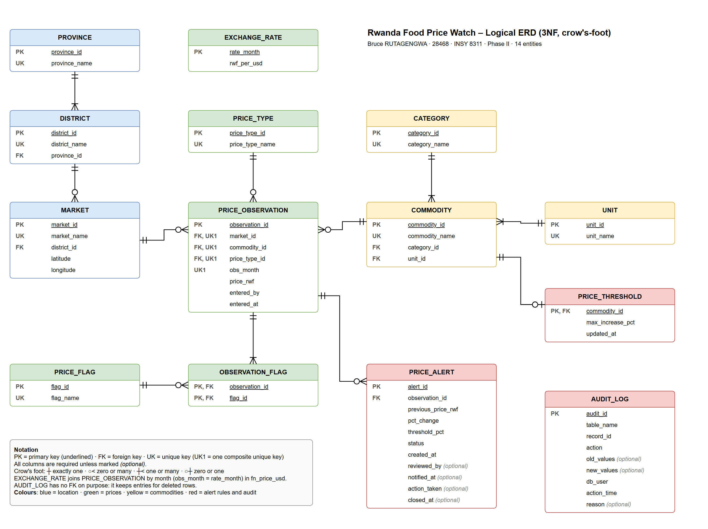

# Rwanda Food Price Watch

| | |
|---|---|
| **Student** | Bruce RUTAGENGWA |
| **Student ID** | 28468 |
| **Group** | Wednesday Grp C |
| **Course** | INSY 8311 – Database Development with PL/SQL |
| **Instructor** | Eric Maniraguha |
| **Repository** | [github.com/brucerut/bruce_28468_foodPriceWatch](https://github.com/brucerut/bruce_28468_foodPriceWatch) |

## Problem statement
Food prices in Rwandan markets change sharply between seasons and between districts. WFP publishes
monthly price data, but only as one flat file. Cooperatives, local authorities and households cannot
easily see when a staple such as beans or maize suddenly becomes expensive in their market. Price
spikes are noticed late, so there is no early warning.

## Objectives
**Main objective:** Build an Oracle database with PL/SQL that stores Rwandan market food prices in
normalized form and automatically detects and reports abnormal price increases.

**Specific objectives:**
1. Normalize the WFP price file to 3NF (province, district, market, commodity, price observation).
2. Load and validate more than 150,000 real price records using PL/SQL.
3. Detect month-over-month price spikes per market and commodity with functions, cursors and triggers.
4. Audit every change to price data and enforce a restriction rule on data entry.
5. Show prices and alerts on a live Power BI dashboard connected to Oracle.

## Data source
WFP – World Food Programme (2026). *Rwanda – Food Prices* [Data set]. Humanitarian Data Exchange.
https://data.humdata.org/dataset/wfp-food-prices-for-rwanda. Licence: CC BY-IGO. See the [dataset card](data/dataset_card.md).

## Innovation
**Option:** Analytics dashboard · **Tool:** Power BI (connected live to Oracle).
The dashboard shows a map of markets coloured by current price change, price trends by commodity and
district, and the open price alerts. A nightly `DBMS_SCHEDULER` job runs the spike-detection procedure,
so new alerts appear without anyone running SQL by hand.

## Planned tables
| Table | Purpose |
|---|---|
| `PROVINCE` | 5 provinces (admin1) |
| `DISTRICT` | 30 districts (admin2), FK → PROVINCE |
| `MARKET` | 109 markets with latitude/longitude, FK → DISTRICT |
| `CATEGORY` | Commodity categories (cereals and tubers, pulses and nuts, …) |
| `COMMODITY` | 65 commodities, FK → CATEGORY |
| `UNIT` | Units of measure (KG, L, …) |
| `PRICE_OBSERVATION` | One price per market, commodity, unit, price type and month |
| `EXCHANGE_RATE` | RWF per USD per month (removes the derived `usdprice` column) |
| `PRICE_THRESHOLD` | Allowed % increase per commodity before an alert |
| `PRICE_ALERT` | Generated spike alerts and their status |
| `AUDIT_LOG` | Who changed what and when, including denied attempts |

## Planned PL/SQL features
- **Procedure** `record_price`: inserts one observation and raises `e_invalid_price` if the price is ≤ 0 or the market is unknown.
- **Function** `fn_pct_change`: returns the % change from the previous month for a market and commodity.
- **Function** `fn_price_usd`: converts RWF to USD using `EXCHANGE_RATE`.
- **Cursor** in `generate_alerts`: loops over the latest month's observations and inserts a `PRICE_ALERT` when the change exceeds `PRICE_THRESHOLD`.
- **Package** `pkg_price_watch`: groups the procedures and functions above.
- **Trigger** `trg_price_audit`: writes every INSERT/UPDATE/DELETE on `PRICE_OBSERVATION` to `AUDIT_LOG`.
- **Trigger** for the restriction rule (defined in Phase VI): blocks data entry outside the allowed days and logs the denied attempt.
- **Analytic SQL** (`LAG`, `AVG OVER`): computes trends for the dashboard.

## Phase I – Business Process Modeling

**Selected process:** monthly market price collection, validation and price-spike alert handling.
On the 15th of each month an enumerator records market prices and hands the sheet to a data entry
officer, who enters each price through `record_price`. Oracle enforces the restriction rule, validates
the price, stores it in `PRICE_OBSERVATION` and audits it. A nightly `DBMS_SCHEDULER` job compares each
price with the previous month and creates a `PRICE_ALERT` when the increase is above the commodity's
threshold. A food security analyst reviews the alert on the Power BI dashboard. A false alarm leads to a
price correction. A genuine spike goes to the district agriculture officer, whose action is recorded
before the alert is closed and later archived.

| | |
|---|---|
| **Actors (swimlanes)** | Market Price Enumerator · Data Entry Officer · Price Watch System (Oracle + PL/SQL) · Food Security Analyst · District Agriculture Officer |
| **Notation** | BPMN 2.0 with swimlanes; tasks coloured by data activity (Create / Retrieve / Update / Delete-Archive) |
| **Modeling tool** | draw.io (diagrams.net) |
| **Published diagram** | [Open the diagram in draw.io](https://viewer.diagrams.net/?highlight=0000ff&nav=1&title=business_process_diagram.drawio#Uhttps%3A%2F%2Fraw.githubusercontent.com%2Fbrucerut%2Fbruce_28468_foodPriceWatch%2Fmain%2Fdocs%2Fbusiness_process%2Fbusiness_process_diagram.drawio) |
| **Diagram (PDF)** | [docs/business_process/business_process_diagram.pdf](docs/business_process/business_process_diagram.pdf) |
| **Editable source** | [docs/business_process/business_process_diagram.drawio](docs/business_process/business_process_diagram.drawio) |
| **Explanation** | [docs/business_process/business_process_explanation.pdf](docs/business_process/business_process_explanation.pdf) |

## Phase II – Data Sourcing, Normalization and Logical Design

The raw WFP files are kept unedited in `data/raw/` (157,793 price rows and 320 markets, with SHA-256
checksums in the dataset card). A full quality check found 0 missing values, 0 duplicates and 0
invalid dates, plus 15 issues that are counted but left unfixed until Phase IV. The main ones:
6,520 non-atomic `actual,aggregate` flags, 2,246 rows with a placeholder district (Gisenyi), a
constant `currency` column, and a derived, rounded `usdprice`.

Normalizing UNF → 1NF → 2NF → 3NF with real rows gives **14 tables**: 11 hold the data from the raw
files and 3 support the PL/SQL rules. A junction table, OBSERVATION_FLAG, resolves the many-to-many
relationship between prices and flags.

| Deliverable | File |
|---|---|
| Dataset card (source, licence, size, record meaning, quality counts) | [data/dataset_card.md](data/dataset_card.md) |
| Raw data (never edited) | [data/raw/](data/raw/) |
| Normalization, step by step, with a traced record | [docs/design/normalization.md](docs/design/normalization.md) |
| Logical ERD, crow's-foot ([editable source](docs/design/erd.drawio)) | [docs/design/erd.png](docs/design/erd.png) |
| Data dictionary + source-to-target mapping | [docs/design/data_dictionary.md](docs/design/data_dictionary.md) |



## Phase III – Database (PDB) Creation

Built on Oracle Database 21c Express Edition (CDB `XE`) on my local machine.

| Item | Value |
|---|---|
| Pluggable database | `c_28468_bruce_pricewatch_db` (27 characters; "foodpricewatch" shortened to "pricewatch" to stay within 30). Open READ WRITE, state saved |
| Admin user | `bruce_admin` with the DBA role (lab-only password = first name, as the brief requires) |
| Data tablespace | `pricewatch_data`: 100M, AUTOEXTEND ON NEXT 10M MAXSIZE 1G (user default) |
| Index tablespace | `pricewatch_idx`: 50M, AUTOEXTEND ON NEXT 10M MAXSIZE 500M |
| Temporary tablespace | `pricewatch_temp`: 50M, AUTOEXTEND ON NEXT 10M MAXSIZE 500M (user temporary) |
| Quota | UNLIMITED on `pricewatch_data` and `pricewatch_idx` |
| Archive log mode | ARCHIVELOG (enabled on the local install only; it is a CDB-wide setting, see `04_archive_log.sql`) |
| EM Express | https://localhost:5568/em (55 + last two digits of 28468) |

Run the scripts in order from the repository root:

```
sqlplus /nolog @database/setup/01_create_pdb.sql    -- SYSDBA: create, open, save state
sqlplus /nolog @database/setup/02_create_user.sql   -- SYSDBA: DBA role, EM port, test login
sqlplus /nolog @database/setup/03_tablespaces.sql   -- bruce_admin: tablespaces, defaults, quotas
sqlplus /nolog @database/setup/04_archive_log.sql   -- SYSDBA: show mode; enable ARCHIVELOG (local only)
sqlplus /nolog @database/setup/05_verify.sql        -- bruce_admin: verification queries
```

Each script spools its output to [screenshots/](screenshots/). EM Express screenshots are in the same folder.

## Repository structure
```
data/raw/                 raw WFP CSV files, exactly as downloaded
data/dataset_card.md      source, licence, size and data quality report
docs/design/              Phase II normalization, ERD and data dictionary
database/setup/           Phase III SQL scripts 01-05 (PDB, user, tablespaces, archive log, verify)
screenshots/              Phase III query output and EM Express screenshots
docs/research/            research_log.md
docs/proposal/            proposal (max 2 pages)
docs/presentation/        Phase 0 slides
docs/business_process/    Phase I diagram (PDF + draw.io source) and explanation
```

## References
1. Cuesta, J., Htenas, A., & Tiwari, S. (2014). Monitoring global and national food price crises. *Food Policy, 49*, 84–94. https://doi.org/10.1016/j.foodpol.2014.06.001
2. Habyarimana, J. B., Munyemana, E., & Impeta, F. B. (2014). Food prices volatility in Rwanda: A VAR model. *World Journal of Agricultural Research, 2*(6), 296–302. https://doi.org/10.12691/wjar-2-6-9
3. Oracle. (n.d.). DBMS_SCHEDULER. In *Oracle Database PL/SQL packages and types reference* (19c). https://docs.oracle.com/en/database/oracle/oracle-database/19/arpls/DBMS_SCHEDULER.html
4. Warner, J., Benimana, G. U., Mugabo, S., Niyonsingiza, J., Mukangabo, E., & Ingabire, C. (2024). *Rwandan maize market price dynamics: Structure, trends and policy implications* [Policy brief No. 15]. International Food Policy Research Institute. https://hdl.handle.net/10568/152398
5. World Food Programme. (n.d.). *HungerMap LIVE*. https://hungermap.wfp.org
6. World Food Programme. (2026). *Rwanda – Food prices* [Data set]. Humanitarian Data Exchange. https://data.humdata.org/dataset/wfp-food-prices-for-rwanda

Key findings and the gap each source shows: [docs/research/research_log.md](docs/research/research_log.md).
